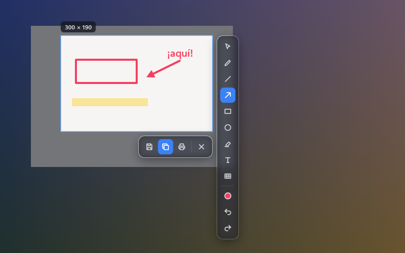

<p align="center">
  <picture>
    <source media="(prefers-color-scheme: dark)" srcset="docs/assets/logo-dark.svg">
    
  </picture>
</p>

<p align="center">
  <b>Press Print Screen, pick an area, mark it up, paste it anywhere.</b><br>
  A fast, offline screenshot tool for Windows.
</p>

<p align="center">
  <a href="../../releases/latest">Download</a> ·
  <a href="#features">Features</a> ·
  <a href="#keyboard-shortcuts">Shortcuts</a> ·
  <a href="#build-from-source">Build</a> ·
  <a href="README.es.md">Español</a>
</p>

<p align="center">
  <br>
  <sub>The selector and its toolbars, rendered from the app's own UI code over a synthetic desktop.</sub>
</p>

## What it is for

SScreentify lives in the notification area. When you press **Print Screen**, the whole screen freezes under a dark veil. You drag a rectangle, draw on it if you want (arrows, boxes, text, a highlighter, censor blocks), and then **copy** it (Ctrl+C) to paste into a chat, email or document, or **save** it (Ctrl+S) as a file.

It is built for the everyday "show someone what I mean" screenshot: open instantly, annotate fast and get out of the way. It never touches the network.

### A test bed for REA

SScreentify is also a hands-on test of reverse engineering with [REA (Reverse Engineer Anything)](https://github.com/morluto/rea). The project was a way to try REA's workflow on a real desktop app: study how a feature works and then rebuild it as clean, original code.

## Features

- **Instant selector** on every monitor, with per-monitor DPI support. It opens in about 30 ms.
- **Precise selection:** 8 handles, arrow keys to move it and Shift + arrow keys to resize it. The size label shows physical pixels. Ctrl+A selects the monitor under the cursor; press it again for the whole desktop.
- **Editor:** pen, line, arrow, rectangle, circle, highlighter, text and color, with undo and redo. The mouse wheel changes the stroke width or font size, and Shift snaps to 45° angles and perfect squares and circles. Every annotation stays editable: select it with V to move, resize or delete it.
- **Censor:** pixelate, blur or a solid block, always computed from the original pixels and burned into the exported image. Use the solid block for sensitive data, because pixelation and blur can be partly reversed.
- **Copy:** puts the image on the clipboard as PNG and as a standard bitmap, so it pastes into both modern and older apps.
- **Save:** PNG, JPG (adjustable quality) or BMP, with no metadata. Files are named by date and time, and an instant save never replaces an earlier one.
- **Print** straight from the selector.
- **Save the full screen instantly** with an optional second shortcut (off by default).
- **Takes Print Screen from the Windows Snipping Tool** while SScreentify is running, without changing any Windows setting.
- **English and Spanish.** It follows the Windows display language by default, and you can change it in Options.
- **Options:** notices, include the cursor, remember the last selection, start with Windows, language, shortcuts, default format, JPG quality and default folder.
- **Light on resources:** about 55 MB of memory while idle.

## Download and install

1. Download `SScreentify-Setup-<version>.exe` from the [latest release](../../releases/latest).
2. Run it. It installs for your user only (under `%LOCALAPPDATA%\Programs\SScreentify`), so it does not need administrator rights.
3. SScreentify starts in the notification area. Press **Print Screen** to capture, or left-click the tray icon.

Requirements: Windows 10 version 1903 or later, 64-bit. The installer includes everything it needs, so you do not have to install .NET.

> **Windows SmartScreen:** the installer is not code-signed yet, so Windows may show "Windows protected your PC". Choose **More info › Run anyway** if you trust the download.

To uninstall, use **Settings › Apps › Installed apps › SScreentify**. Your settings (`%APPDATA%\SScreentify`) and your saved screenshots are kept.

## Keyboard shortcuts

| Where | Shortcut | Action |
|---|---|---|
| Anywhere | Print Screen | Open the selector (configurable) |
| Anywhere | *(optional)* | Save the full screen instantly |
| Selector | Ctrl+C | Copy and close |
| Selector | Ctrl+S | Save as… |
| Selector | Ctrl+P | Print |
| Selector | Esc, Ctrl+X or right-click outside | Close without saving |
| Selector | Ctrl+A | Select the monitor; press again for the whole desktop |
| Selector | Arrow keys / Shift + arrow keys | Move / resize the selection |
| Editor | Ctrl+Z, Ctrl+Y or Ctrl+Shift+Z | Undo, redo |
| Editor | V | Select annotations; Delete removes the selected one |
| Editor | Mouse wheel | Stroke width or font size |
| Editor | Shift while drawing | 45° angles, squares and circles |

### Print Screen on Windows 11

Windows 11 can reserve Print Screen for the Snipping Tool. While SScreentify is running it reads the key directly from the keyboard, so Print Screen opens SScreentify instead; when you exit it, the key goes back to the Snipping Tool. No Windows setting is changed.

**Known limitation:** while a window running as administrator is in the foreground, Windows does not let a normal app read the keyboard, so Print Screen opens the Snipping Tool there. Left-click the tray icon instead.

## Privacy

SScreentify makes no network requests and has no telemetry or accounts. Screenshots only go where you copy or save them. Settings are a small JSON file at `%APPDATA%\SScreentify\settings.json`.

## Build from source

You need Windows and the [.NET 8 SDK](https://dotnet.microsoft.com/download/dotnet/8.0).

```powershell
dotnet test                                # unit and UI tests
dotnet run --project src\SScreentify.App   # run from source
.\scripts\publish.ps1                      # self-contained single-file publish\SScreentify.exe
.\scripts\build-installer.ps1              # dist\SScreentify-Setup-<version>.exe (needs Inno Setup 6)
```

To install Inno Setup: `winget install --id JRSoftware.InnoSetup -e --source winget`. The version comes from `<Version>` in `src/SScreentify.App/SScreentify.App.csproj`.

Useful switches: `--perf` writes timings and memory to `%APPDATA%\SScreentify\perf.log`, and `--gpu-render` uses GPU rendering instead of the default software rendering.

### How it is built

- **C# and WPF on .NET 8.** `SScreentify.Core` holds the pure logic: geometry, annotations, censoring, settings and shortcuts. `SScreentify.App` holds the Windows parts: capture, overlay, rendering, export and UI.
- **Capture:** GDI captures the whole virtual desktop in physical pixels, and each monitor gets its own overlay window that converts to its DPI only when drawing.
- **Rendering:** software rendering is the default, because GPU rendering kept about 70 MB of driver memory alive after the first capture.

Developer notes (in Spanish), with the code map and known pitfalls, are in [docs/CONTINUAR.md](docs/CONTINUAR.md).

### Performance

Measured on one 1920×1080 monitor with the published build:

| Measure | Result |
|---|---|
| Key press → selector visible (warm, 20 runs) | median 30.6 ms, p95 33.6 ms |
| Cold start to tray | ~0.5 s |
| Idle memory after a capture (private) | 54.7 MB |
| Censor blur while dragging, 600×400 area | 8–10 ms per update |

Not yet measured: several monitors, mixed scaling and 4K.

## License

[MIT](LICENSE) © 2026 Diego Muñoz.

The logo and name are SScreentify's own; the wordmark uses [Space Grotesk](https://fonts.google.com/specimen/Space+Grotesk) (SIL Open Font License), converted to outlines.
